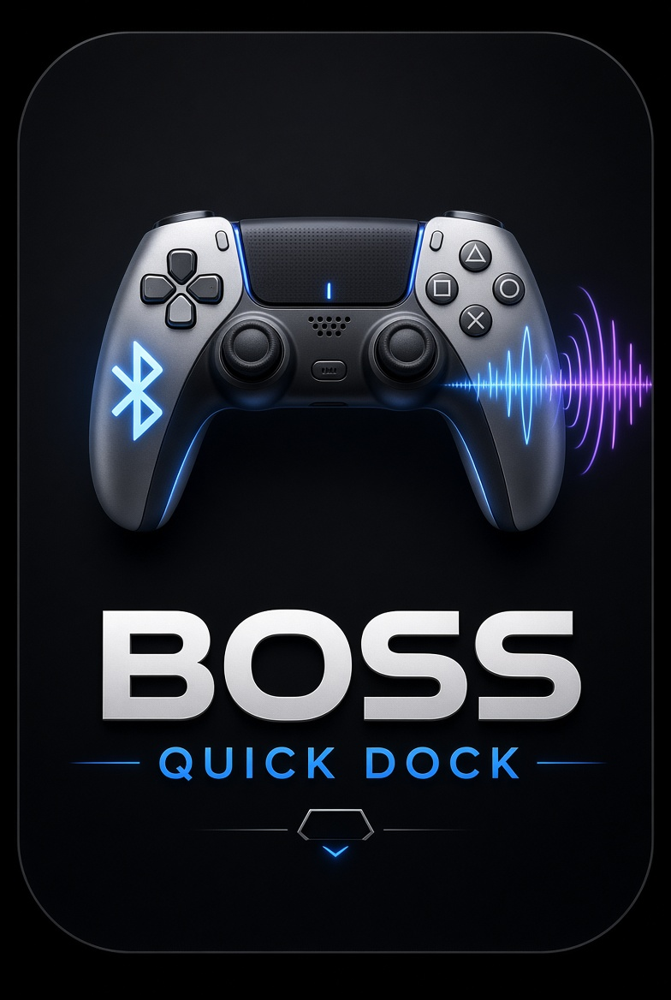
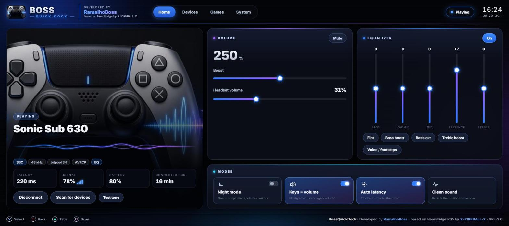
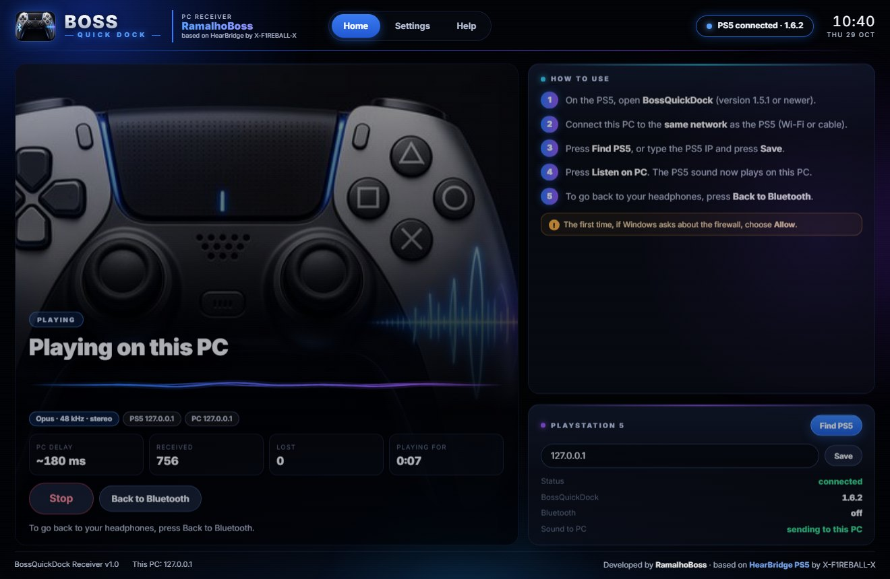
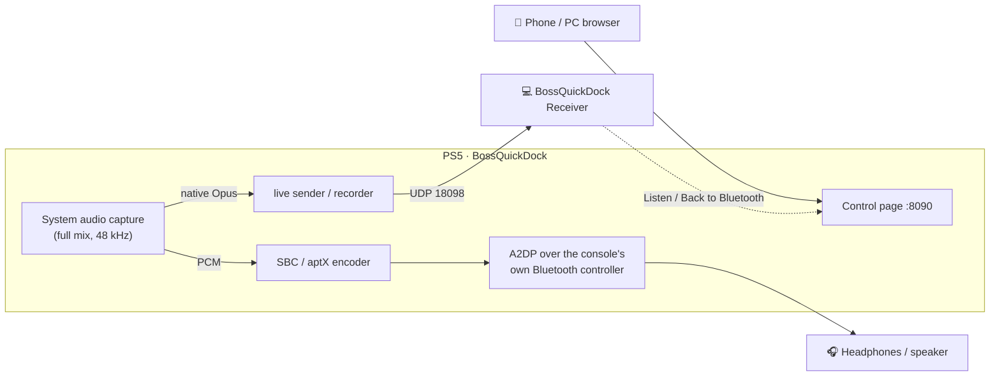

<div align="center">



# BossQuickDock

**Bluetooth headphones and speakers on a jailbroken PS5 — and the PS5 sound on your PC. Game and system audio, no dongle.**

Developed by **RamalhoBoss** · based on **[HearBridge PS5](https://github.com/X-F1REBALL-X/HearBridge-PS5) by X-F1REBALL-X**

[**Download 1.6.3**](https://github.com/ramalhoboss/BossQuickDock/releases/latest) · [What's new](docs/whats-new-1.6.md) · [PC Receiver](docs/pc-receiver.md) · [Building](docs/building.md)

</div>

<p align="center"></p>

## What's new in 1.6

- **PS5 audio on your PC** — the new [BossQuickDock Receiver](docs/pc-receiver.md) for Windows: unzip, double-click, **Find PS5**, **Listen on PC**. The console's own Opus encoder sends the sound over the LAN; **Back to Bluetooth** gives it back to your headset.
- **Native recording** of the PS5 mix as AAC or Opus, with downloads.
- **Capture that heals itself**, and the cause of the "silent until restart" capture error found and fixed (64 KB read buffer) — [Avcap2 internals](docs/avcap2-internals.md).
- **Diagnostics studio** on the control page: queue / bitpool charts, stability tests, JSON report, readability modes.
- **1.6.3:** SBC-XQ goes back to SBC by itself when the link cannot carry it, also when you picked it by hand — [best Bluetooth quality](docs/whats-new-1.6.md#163-the-best-bluetooth-quality).

Full story, with diagrams and measurements from the console: **[What's new in 1.6](docs/whats-new-1.6.md)**.

<p align="center"></p>

## How it works



## Downloads

Every release has three files:

| File | What it is |
|---|---|
| `BossQuickDock-<version>.elf` | The PS5 app |
| `BossQuickDock-<version>.zip` | The same ELF zipped, with LICENSE and NOTICE |
| `BossQuickDock-Receiver-<version>-windows.zip` | The PC Receiver for Windows, with its own Python — nothing to install |

## Install

**On the PS5**

1. Jailbreak your PS5 and run an ELF loader (firmware up to 14.10 supported; tested on 13.60).
2. Send `BossQuickDock-1.6.3.elf` to the console (for example, copy it to `/data/pldmgr/payloads/local` and launch it from your payload manager). If an older BossQuickDock is running, press **Stop app** first.
3. Open the **BossQuickDock** tile on the home screen, or browse to `http://<console-ip>:8090` from a phone or PC.
4. Put your headphones in pairing mode and press **Scan for devices**.

**On the PC (optional)** — unzip `BossQuickDock-Receiver-1.0-windows.zip`, double-click `BossQuickDock Receiver.cmd` and follow the steps on its Home screen. [Guide](docs/pc-receiver.md)

## Credits

All credit for the core of this project goes to **X-F1REBALL-X** and his work on **HearBridge PS5** — the Bluetooth stack, A2DP/SBC streaming, the control page and everything that makes PS5 audio reach your headphones is his. Thank you for releasing the source code. 🙏

BossQuickDock is a modified build of HearBridge PS5, released under the same license (GPL-3.0-or-later). See [NOTICE](NOTICE).

## What's different from HearBridge

**Bug fixes**

- **Capture that went silent until a restart** (1.6.2) — the console's capture library returns the same error forever when a packet is bigger than the read buffer; the buffer is now 64 KB, and the capture reopens itself (bounded) after bad reads, a lost mapping or 5 s without sound.
- **DualSense stuck on a solid white light** after it disconnected while the app had the Bluetooth chip open — it now reconnects without rebooting the console. The USB transport no longer cancels pending transfers (which hung the system's Bluetooth stack until a reboot): extra reads are completed with harmless HCI / L2CAP echo traffic instead.
- **System replies taken by the app** are given back: if the app reads an HCI Command Complete/Status meant for the console, it steps aside and replays a rejected copy of that command so the system gets its answer.
- **Audio stutter while streaming** — all reads stay armed during playback, so credits are never starved; the pacing clock no longer piles up waits after a stall (1.6.2).
- **Incoming headset / speaker connections timing out** — a device that connects to the console is now recognised as the app's own link.
- **Log file growing forever** (134 MB+) — capped, and turned off in the release build.
- **Pairing that only worked after several tries** (1.1.1) — the console's own Bluetooth stack sometimes took the "connected" event of a new link and hung up on it; the app then stepped aside for 45 s and the pairing timed out. It now pauses 2 s and pages the device again by itself (twice at most). The DualSense reconnect fix is unchanged.

**New**

- **PS5 audio on your PC** (1.6.2): live Opus over UDP to the [BossQuickDock Receiver](docs/pc-receiver.md).
- **Native AAC / Opus recording** (1.6.2) with ADTS / Ogg / raw downloads.
- **Diagnostics studio** (1.6.2): charts, capture health, stability tests, JSON report; Standard / Large / TV text.
- Brand-new control page with a PlayStation-style look, live waveform, tabs for Home / Devices / Games / System
- New name, icon and home-screen tile
- **aptX** (1.1.0) for headsets with a Qualcomm aptX decoder: pick **aptX** under System → Codec. It only lights up when the connected headset advertises aptX at 48 kHz stereo; Auto stays plain SBC. The encoder is a port of FFmpeg's (byte-for-byte identical output, checked by `make test-aptx`).
- **Low battery on screen** (1.1.0): a console notification at 20 % and 10 %, not only on the control page; "connection lost" now names the headset.
- **Firmware 14.00 / 14.10** (1.1.0): built with PS5 Payload SDK v0.45, which adds the kernel offsets for these firmwares.

## Build

Requires the [PS5 Payload SDK](https://github.com/ps5-payload-dev/sdk) (v0.45 or newer).

```bash
make test
make ps5 PS5_PAYLOAD_SDK=/opt/ps5-payload-sdk
```

On Windows without WSL: `powershell -File scripts\build_ps5_win.ps1 -Sdk C:\path\to\ps5-payload-sdk` (needs LLVM 18). GitHub Actions runs the tests, builds the ELF and packages both downloads on every push. Details: [Building](docs/building.md).

The ELF is written to `dist/BossQuickDock-<version>.elf`. Build with `-DBQD_LOG_TO_FILE=1` to get a debug log in `/data/hearbridge/hearbridge.log`.

## Documentation

- [What's new in 1.6](docs/whats-new-1.6.md) — every change since 1.1.2, with diagrams and console measurements
- [PC Receiver](docs/pc-receiver.md) — install, use, the UDP stream, how it is built
- [Avcap2 internals](docs/avcap2-internals.md) — how the PS5 audio capture really works (reverse engineered)
- [Building](docs/building.md) — CI, Linux, Windows

## License

GPL-3.0-or-later, like the original HearBridge PS5. See [LICENSE](LICENSE) and [NOTICE](NOTICE).
