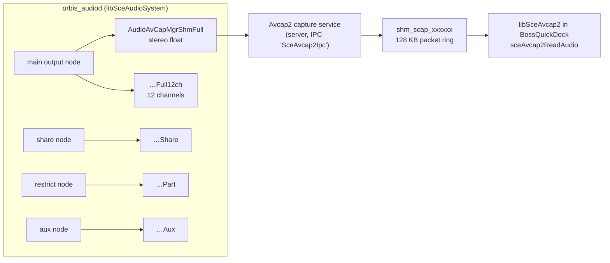
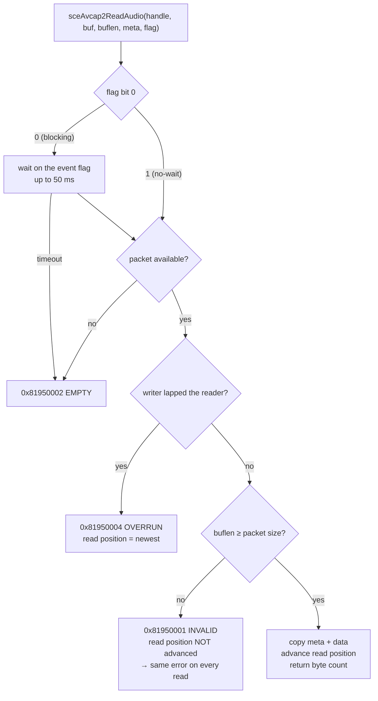
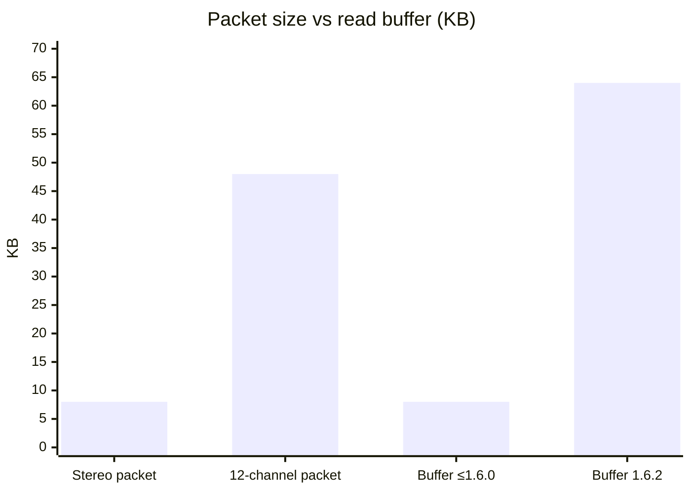
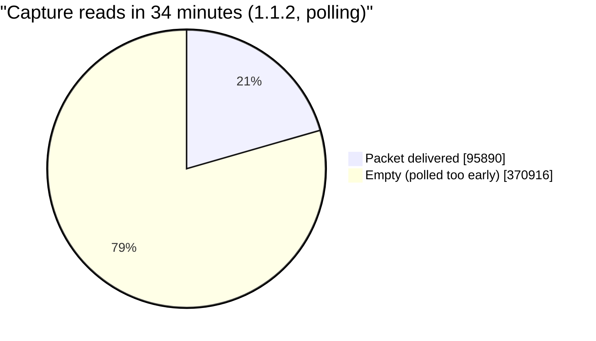
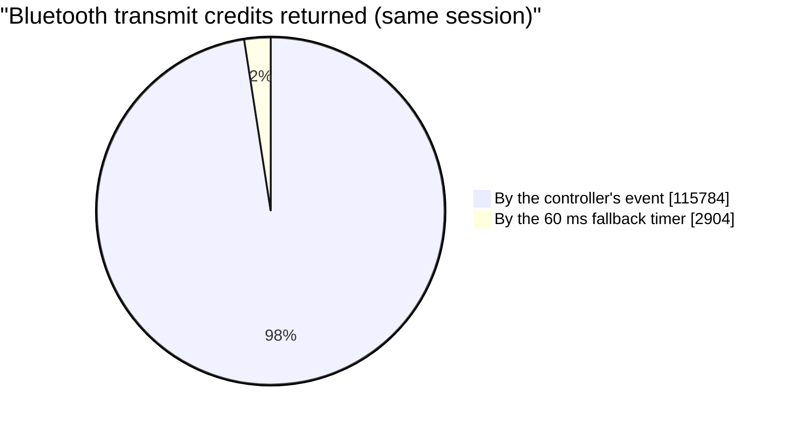

# Avcap2 internals

How the PS5 system-audio capture that BossQuickDock uses really behaves, from reverse engineering `libSceAvcap2.sprx` and `libSceAudioSystem.sprx` in memory dumps of a firmware 13.60 console (BossQuickDock 1.1.2 running, and `orbis_audiod` on the menu and in a game). Tools: [REA](https://github.com/morluto/rea) with Ghidra; the memory regions were wrapped in a PE image at their original addresses so the functions keep their real addresses.

These findings are behind the 64 KB read buffer and the capture counters in 1.6.2.

## Where the sound comes from

Each output node of the audio daemon writes its own 128 KB ring, but **only while that node is active**:

| Ring | Menu (no game) | In a game |
|---|---|---|
| Full (stereo) | sound | sound |
| Full12ch | 2 of 12 channels | 2 of 12 channels, ~6 dB lower |
| Share | silent | sound, **bit-identical to Full** |
| Part ("restrict") | silent | sound, bit-identical to Full |
| Aux | silent | sound, bit-identical to Full |
| PadSpk / Cronos12ch | not even allocated | not allocated |

The four game-time copies matched sample for sample once shifted by the moment each region was dumped; the shifts matched the microsecond timestamps in the ring headers exactly. BossQuickDock opens the capture with `source = 2` and gets sound on the menu, where only Full runs — so it captures the **full mix**, including system sounds. The DualSense speaker mix (PadSpk) is not available in normal mode.

## The open parameters

`sceAvcap2OpenAudio(&handle, param, 0)` only forwards a 0x38-byte parameter block over IPC (method `0xa70000`) to the capture service. What is known of it:

| Offset | Meaning | PCM (Bluetooth) | Native Opus / AAC |
|---|---|---|---|
| 0x00 | size | 0x38 | 0x38 |
| 0x08 | — | 0x18 | 0x18 |
| 0x10 | `1` opens a second stream | 0 | 0 |
| 0x14 | source (2 = full mix) | 2 | 2 |
| 0x18 | format | 0 (PCM) | 1 = AAC, 2 = Opus |
| 0x1c | — | 0xffffffff | 0xffffffff |
| 0x28 | bitrate | — | 128000 |
| 0x30 | Opus option | — | 1 |

## The packet ring

The capture arrives in a 128 KB shared-memory ring mapped into the app (`shm_scap_xxxxxx`), as whole packets:

| Where | Bytes | Content |
|---|---|---|
| ring header | 16 | size (0x20000), write position, ?, wrap count |
| packet header | 16 | meta length (16), 0x2000, data length, 0 |
| packet meta | 16 | 0x10, 0, counter (+0x14 per packet), 0 |
| packet data | 8192 | 1024 frames of stereo float, 21.3 ms |

The ring holds about **16 packets ≈ 340 ms**. A reader that falls further behind gets `0x81950004` (overrun) and is moved to the newest packet — that much audio is gone.

In the dumped 34-minute session the ring had wrapped 6,011 times (≈ 788 MB), matching the app's own count of good reads × 8 KB.

## What a read does

The `INVALID` branch is the "sticky" error earlier builds worked around by restarting the capture three times and then giving up in silence. With an 8 KB buffer any packet larger than one stereo packet (12-channel float is 48 KB) jams the reader for good. 1.6.2 reads with a 64 KB buffer; a packet is still handed over one at a time, so nothing else changes.

Blocking mode (`flag 0`) is safe: it waits at most 50 ms (`0xc350` µs, `ETIMEDOUT` → `EMPTY`). BossQuickDock keeps the no-wait read and its own pacing.

## What the app's memory showed

The same dump held the app's own counters and log tail (34 minutes into a session with a Sonic Sub 630 on 1.1.2):

About 2.4 % of the controller's "packets completed" events never reached the app (the console's own Bluetooth stack reads the same USB endpoint), so the app recovered those credits with a 60 ms timer. Those 60–90 ms gaps are harmless with the paced queue, but they are exactly what broke the experimental direct SBC path in 1.6.1 — see [What's new](whats-new-1.6.md#the-161-dropouts-and-the-fix-in-162).

## Open questions

- The capture service process (server of `SceAvcap2Ipc`) was not in the dumps, so offsets 0x08, 0x10 and 0x1c of the open parameters are still unexplained.
- Whether a game sending sound only to the DualSense speaker or headphone port is in the Full mix is not known.
