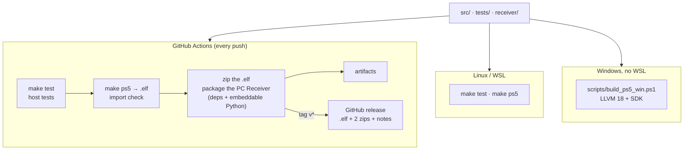

# Building

The console app is one ELF built with the open-source [PS5 Payload SDK](https://github.com/ps5-payload-dev/sdk) (v0.45, which carries the kernel offsets up to firmware 14.10) and clang 18. There are three ways to build it.



## GitHub Actions

Every push runs `.github/workflows/ci.yml`: the host tests, the payload build with its import check, then the two downloads (`BossQuickDock-<version>.zip` and `BossQuickDock-Receiver-<version>-windows.zip`). They are kept as run artifacts. Pushing a `v<version>` tag also publishes the release with the `.elf`, both zips and `release-notes/v<version>.md` as its text.

## Linux or WSL

```bash
make test
make ps5 PS5_PAYLOAD_SDK=/opt/ps5-payload-sdk
```

`make test` needs cc, ffmpeg, python3 with numpy, and node. The ELF is written to `dist/BossQuickDock-<version>.elf`. Add `CFLAGS+=-DBQD_LOG_TO_FILE=1` for a debug log in `/data/hearbridge/hearbridge.log`, or `-DBQD_DIRECT_SBC=1` to try the experimental direct SBC path.

The control page is generated: edit `src/web/ui.html`, `studio.js`, `monitor.js` or `i18n.json`, then

```bash
python3 scripts/build_ui.py
python3 scripts/gen_webpage.py src/web/index.html src/webpage.h src/web/i18n.json
```

`make test` fails if `src/webpage.h` is stale.

## Windows without WSL or make

1. Install LLVM 18 (`winget install LLVM.LLVM --version 18.1.8`).
2. Unzip the PS5 Payload SDK v0.45 anywhere (it ships Windows wrappers in `win\`).
3. Build:

```powershell
powershell -File scripts\build_ps5_win.ps1 -Sdk C:\path\to\ps5-payload-sdk
```

The script reads the sources, CFLAGS and libraries from `ps5.mk`, passes the same arguments as the SDK's Linux `prospero-clang` / `prospero-lld`, links through the SDK's `win\prospero-lld.exe` (clang 18 always links PS5 through it) and runs `scripts/check_imports.sh` through Git Bash. The resulting ELF has the same layout as the Linux build. Host tests still need Linux (or CI).

## The import check

The payload runtime loads every needed module and binds every import before `main()`; one missing symbol ends the payload silently. `scripts/check_imports.sh` fails the build if the ELF needs a module or imports a symbol that 1.0.2 did not (`scripts/imports-1.0.2.txt`); newer symbols are looked up at run time instead. 1.6.2: 70 imports, modules `libSceSystemService`, `libkernel_web`, `libSceLibcInternal`, `libSceNet`.
