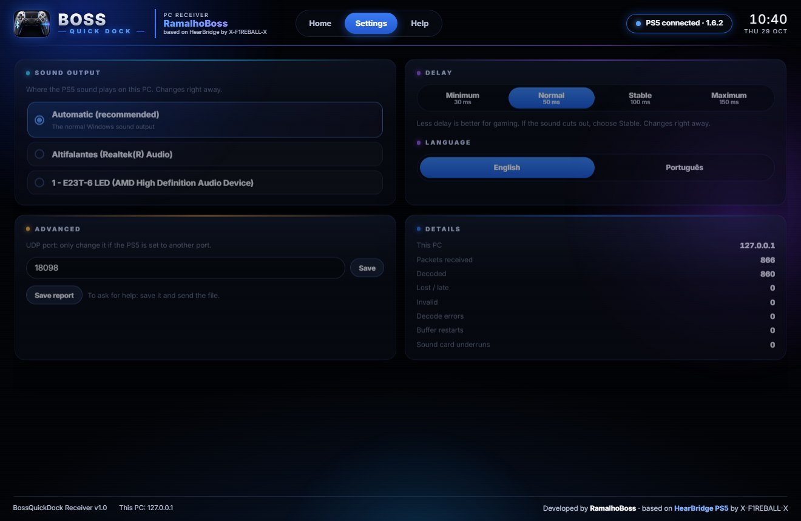
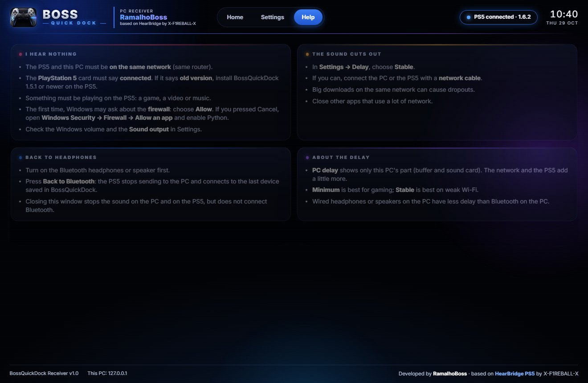
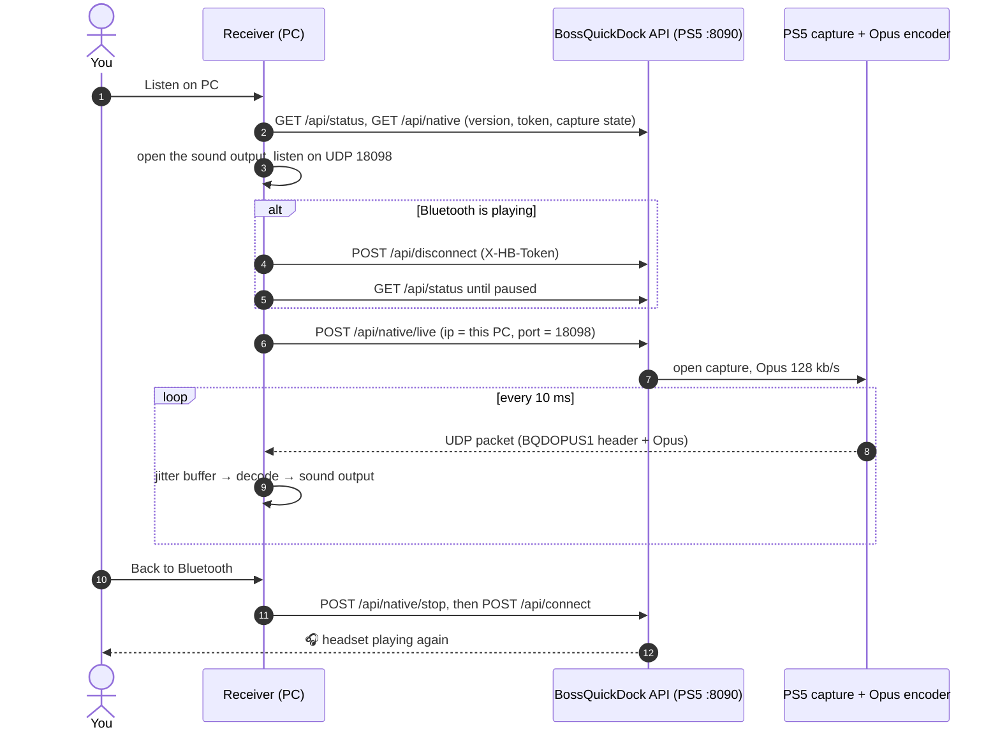
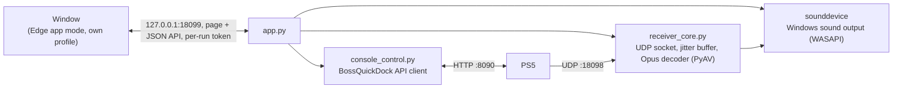

# BossQuickDock Receiver (PC)

Hear your PS5 on a Windows PC. Same look as the BossQuickDock control page, instructions on screen, one button to listen and one to go back to Bluetooth.

## Install

1. Download **`BossQuickDock-Receiver-1.0-windows.zip`** from the [latest release](https://github.com/ramalhoboss/BossQuickDock/releases/latest) and unzip it anywhere.
2. Double-click **`BossQuickDock Receiver.cmd`**. A window opens.

Nothing else to install: the zip carries its own Python 3.12 (`python\`) and the two packages it needs (`deps\`: PyAV for Opus, sounddevice for the sound output). Windows 10/11 64-bit with Microsoft Edge (which draws the window).

## Use

1. On the PS5, open **BossQuickDock 1.6.2** (1.5.1 or newer works too).
2. Connect the PC to the **same network** as the PS5.
3. Press **Find PS5** — the receiver looks for BossQuickDock on the local network (about 4 s) — or type the PS5 IP and press **Save**.
4. Press **Listen on PC**. The receiver turns the PS5 Bluetooth off, asks for the stream, and the sound plays here.
5. **Back to Bluetooth** stops the stream and reconnects the headset or speaker saved in BossQuickDock.

The first time, Windows may ask about the firewall: choose **Allow** (private networks). Closing the window stops the sound on the PC and on the PS5; it does not reconnect Bluetooth.

| Settings | Help |
|---|---|
|  |  |

- **Sound output:** Automatic (the Windows default) or any output; changes right away.
- **Delay:** Minimum 30 ms, Normal 50 ms, Stable 100 ms, Maximum 150 ms of jitter buffer; changes right away without stopping. More delay = fewer cuts on weak Wi-Fi.
- **Language:** English or Português.
- **Advanced:** UDP port (18098) and **Save report** (a JSON file to send when asking for help).

Settings are kept in `%LOCALAPPDATA%\BossQuickDock Receiver\settings.json`.

## What happens when you press Listen on PC

The receiver only reads the console state until you press a button: opening the window or the automatic refresh every 3 s never changes the audio route.

## The UDP stream

One datagram per 10 ms Opus packet, little-endian, from the PS5 to the PC:

| Offset | Size | Field | Value |
|---|---|---|---|
| 0 | 8 | magic | `BQDOPUS1` |
| 8 | 2 | version | 1 |
| 10 | 2 | header length | 48 |
| 12 | 8 | stream ID | new on every start or capture reopen |
| 20 | 4 | sequence | +1 per packet |
| 24 | 8 | native timestamp | +2400 per packet (240 kHz clock) |
| 32 | 8 | sender time | elapsed time on the PS5 |
| 40 | 2 | payload length | 0..1200 (0 = end of stream) |
| 42 | 2 | frames | 480 |
| 44 | 4 | sample rate | 48000 |
| 48 | n | Opus packet | CELT, fullband, stereo, one 10 ms frame |

The receiver only accepts datagrams from the PS5 address you set, keeps a jitter buffer of the chosen size, plays silence for a missing block, and rebuffers after 3 missing blocks in a row, 3 late packets, a 250 ms gap or a queue overflow (keeping the newest packet). It never tries to play stale audio in a burst.

## How the receiver is built

- The page is served on `127.0.0.1` only; every API call needs the token embedded in the page and a `127.0.0.1` / `localhost` Host header, so other web pages cannot drive it.
- Only one copy runs: the page port is opened exclusively, and a second launch just shows the running window.
- The window is Edge in app mode with its own profile, so closing it ends the app; if Edge is missing, the default browser opens instead.

Source: [`receiver/`](../receiver). Run from source with Python 3.12: `pip install --target receiver/deps -r receiver/requirements.txt`, then `python receiver/app.py`.
