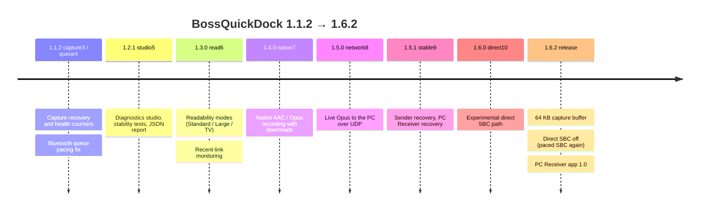
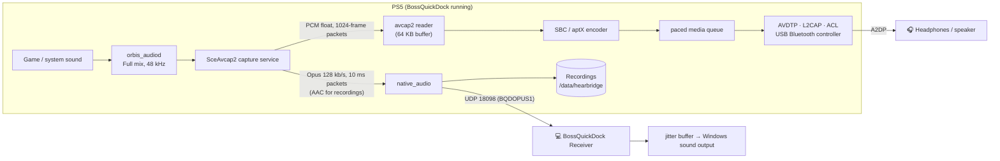
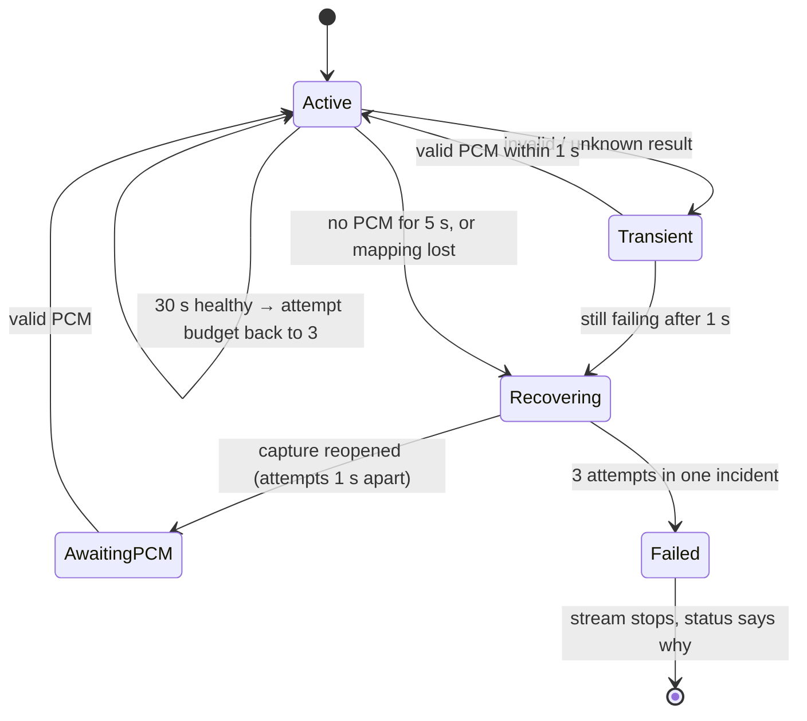
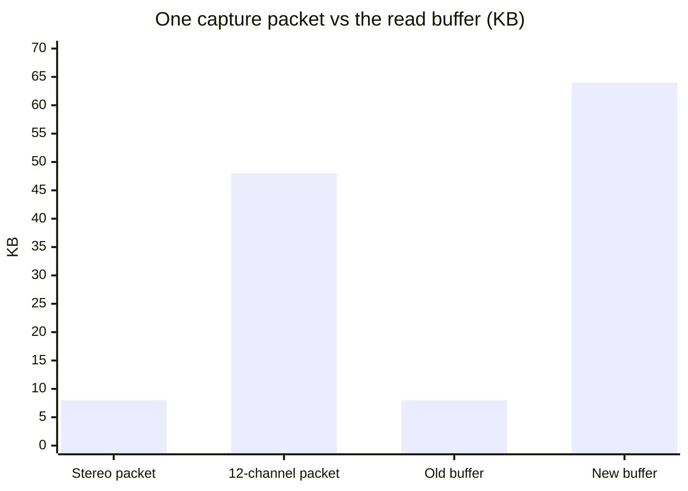
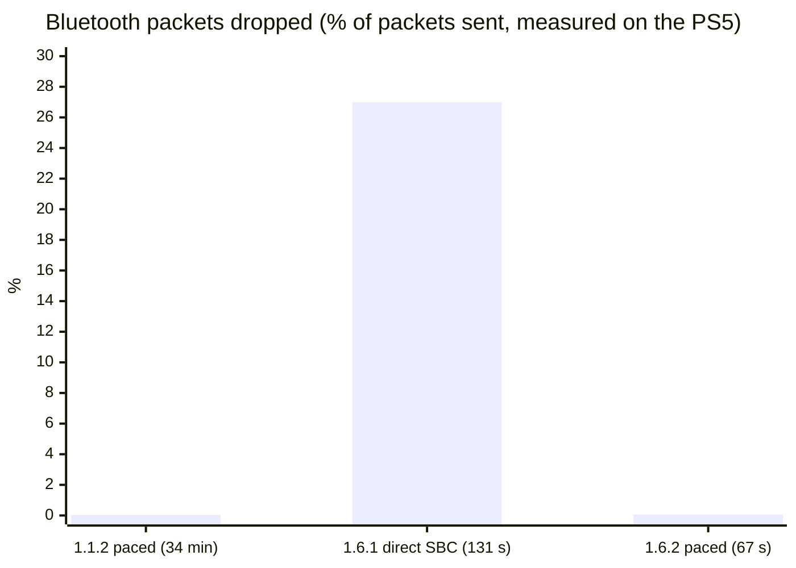

# What's new in 1.6.2

Everything that changed between **1.1.2** and **1.6.2**: the PS5 audio on your PC, native AAC / Opus recording, a capture path that heals itself, a diagnostics studio in the control page, and the fixes found by reverse engineering the console's capture library.

- [The road from 1.1.2 to 1.6.2](#the-road-from-112-to-162)
- [How the audio flows now](#how-the-audio-flows-now)
- [PS5 audio on your PC](#ps5-audio-on-your-pc)
- [Native recording (AAC / Opus)](#native-recording-aac--opus)
- [Capture that heals itself](#capture-that-heals-itself)
- [The 1.6.1 dropouts and the fix in 1.6.2](#the-161-dropouts-and-the-fix-in-162)
- [Control page: studio and readability](#control-page-studio-and-readability)
- [Under the hood](#under-the-hood)

## The road from 1.1.2 to 1.6.2

Several builds were made and tested on the console between the two releases. Only **1.6.2** is published.

| Build | What it added | Published |
|---|---|---|
| 1.1.2-capture3 | Capture always uses the no-wait read; bounded, paced recovery (3 attempts, 1 s apart); 5 s no-data watchdog; `capture health` / `capture counters` in `/api/diag` | no |
| 1.1.2-queue4 | Bluetooth pacing clock no longer piles up future waits while the queue is above its drain limit | no |
| 1.2.1-studio5 | Diagnostics tab with queue and bitpool charts, 1/5/10-minute stability tests, JSON report export, buffer presets, **Stop app** in the header | no |
| 1.3.0-read6 | Panels scroll instead of shrinking, larger text, Standard / Large / TV text modes, recent link drops per minute | no |
| 1.4.0-native7 | **Recording** tab: native AAC or Opus, 12 / 30 / 60 s, downloads as ADTS / Ogg / raw packets | no |
| 1.5.0-network8 | **Live Opus → PC**: the PS5 sends its sound to the PC over UDP port 18098 | no |
| 1.5.1-stable9 | The sender reopens capture (3 times) and its UDP socket by itself; the receiver rebuffers after gaps | no |
| 1.6.0-direct10 | Experimental "direct SBC" Bluetooth path (see below) | no |
| **1.6.2** | Everything above + 64 KB capture buffer + direct SBC **off** + the [PC Receiver](pc-receiver.md) app | **yes** |

## How the audio flows now

The console's capture service gives BossQuickDock the full PS5 mix in two forms: plain PCM for Bluetooth, or already encoded by the console's own Opus / AAC encoder for the PC and for recordings.

Bluetooth and the PC (or a recording) never run at the same time: one capture owner (`capture_guard`) hands the capture to one of them. The PC Receiver switches Bluetooth off before it asks for the stream, and **Back to Bluetooth** gives the capture back.

## PS5 audio on your PC

Open **BossQuickDock Receiver** on a Windows PC on the same network, press **Listen on PC**, and the PS5 sound plays on the PC. The receiver has its own page: **[PC Receiver](pc-receiver.md)**.

- **Codec:** the console's native Opus encoder, 48 kHz stereo, 128 kb/s, one packet every 10 ms.
- **Transport:** plain UDP on the LAN (port 18098). Each packet has a 48-byte `BQDOPUS1` header with a stream ID, a sequence number and the native timestamp ([format](pc-receiver.md#the-udp-stream)).
- **Measured on the console (1.5.1):** 19,716 packets in about 197 s, no send errors, no overruns, no timestamp gaps; the user heard no perceptible delay.
- **Recovery:** the PS5 sender reopens the capture up to 3 times and its UDP socket after repeated send errors; the receiver rebuffers after 3 missing blocks or a 250 ms gap, so a hiccup never turns into a long silence or a growing delay.
- A live session ends by itself after 2 hours.

## Native recording (AAC / Opus)

**Recording** tab on the control page: choose AAC or Opus and 12, 30 or 60 seconds. When it finishes, **Download audio** gives an ADTS (`.aac`) or Ogg Opus file; **Download raw packets** keeps the native packets with their timestamps (`BQDNCP01` container). Files stay in `/data/hearbridge/native-*` on the console.

Bluetooth is disconnected while recording (the capture has one owner) — **Reconnect Bluetooth** brings the headset back.

## Capture that heals itself

Before 1.6, a bad capture read could leave the headset in silence until the app was restarted. Now the reader classifies every result and recovers on its own, within limits:

And the cause of the old "sticky" error is gone. Reverse engineering the console's capture library (`libSceAvcap2`) showed that each read hands over **one whole packet**; when the packet is bigger than the read buffer the library answers `0x81950001` **without moving past it**, so the same error comes back forever. The old buffer was 8 KB — exactly one stereo packet, nothing to spare for a multichannel one. 1.6.2 reads with **64 KB**:

Details, with the ring buffer layout and the read path: **[Avcap2 internals](avcap2-internals.md)**.

## The 1.6.1 dropouts and the fix in 1.6.2

1.6.0-direct10 tried a "direct SBC" path for lower latency: send each 4-frame SBC packet (10.7 ms of audio) as soon as it is encoded, keep at most 3 packets queued and throw away any packet older than 24 ms. On the console with a Sonic Sub 630 it did not survive the Bluetooth controller: the console's controller sometimes returns no transmit credit for 60–90 ms (`acl: gap max` in the log), and with a 30 ms queue every such gap expired packets.

| Build | Path | Audio per packet | Packets sent | Dropped | Bitpool |
|---|---|---|---|---|---|
| 1.1.2 | paced | 7 frames · 18.7 ms | 118,719 | 35 (0.03 %) | 32–35 |
| 1.6.1 (test) | direct | 4 frames · 10.7 ms | 4,220 | **1,139 (27 %)** | fell to 22 |
| **1.6.2** | paced | 8 frames · 21.3 ms | 3,400 | **2 (0.06 %)** | 22 (learned in the 1.6.1 test) |

So 1.6.2 switches the direct path off (`BQD_DIRECT_SBC 0` in `src/a2dp/direct_sbc.h`) and SBC uses the paced queue again, which absorbs those gaps. The code stays in the tree; build with `-DBQD_DIRECT_SBC=1` to experiment with it. aptX was never affected.

The rate controller lowers the SBC bitpool when packets are dropped and remembers the level that held for each headset. It only steps up after 4 s without drops while the controller returns credits with headroom, so in the 1.6.2 test the speaker was still at 22, the level learned during the 1.6.1 test (1.1.2 ran it at 32–35).

## Control page: studio and readability

- **Diagnostics:** Bluetooth queue and SBC bitpool charts (last 120 samples), capture health (valid / empty / overrun / recoveries / no-data), recent link drops per minute with observation gaps excluded.
- **Stability test:** 1, 5 or 10 minutes, with counter deltas and coverage; it cannot pass without enough observed data.
- **Report:** export a JSON report (tokens and key-like values removed, no audio collected).
- **Buffer presets:** Automatic, Quick response (120 ms), Stable (250 ms). These are queue targets, not total latency.
- **Readability:** System → Display & readability: Standard, Large (20 px) or TV (24 px) text; panels scroll instead of shrinking.
- **Stop app** is always visible in the header, next to the build version.

## Under the hood

- **Capture buffer 64 KB** (`src/avcap2.c`), with a regression test that a 48 KB 12-channel packet is read (`tests/test_avcap2_capture.c`, 27 scenarios).
- **Counters in the stream log:** `overrun=` (the reader fell a whole ring behind and the library skipped ahead) and `fills=` (silence chunks sent because capture was late). On 1.6.2 both stay at 0.
- **Timing diagnostics** every 5 s in the log (`timing-diag:`): capture, encode, submit and packet assembly times, software only.
- **Codec discovery** in the log: every endpoint the headset reports and its capabilities (AAC advertised vs selected).
- **Local Windows build** without WSL or make: [Building](building.md).
- **CI** builds the ELF, zips it, and packages the PC Receiver with its own Python for Windows on every push.
